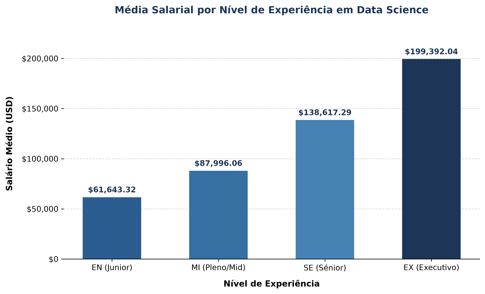

# 📊 Data Science Job Salaries Analysis

Este projeto é uma análise exploratória dos salários na área de Data Science em todo o mundo, desenvolvida com base no conjunto de dados *Data Science Job Salaries* do Kaggle.

---

## 📈 Principais Descobertas

* **Amostra Analisada**: 607 registos de profissionais de dados.
* **Salário Médio Global**: **\$112,297.87 USD / ano**.
* **Média Salarial por Nível de Experiência**:
  * **EN (Júnior)**: \$ 61,643.32 USD
  * **MI (Pleno)**: \$ 87,996.06 USD (+42.8%)
  * **SE (Sénior)**: \$138,617.29 USD (+57.5% — *maior crescimento*)
  * **EX (Executivo)**: \$199,392.04 USD (+43.8%)

---

## 📊 Visualização de Dados



---

## 📁 Estrutura do Repositório

```text
ds-salaries-analysis/
├── dados/
│   └── ds_salaries.csv                     # Conjunto de dados do Kaggle
├── scripts/
│   ├── 01_exploracao.py                    # Análise inicial de dados
│   ├── 02_tabela_carreira.py               # Agregação por nível de experiência
│   └── 03_visualizacao.py                  # Geração do gráfico Matplotlib
├── imagens/
│   └── grafico_salarios_experiencia.png    # Gráfico gerado para o relatório
├── .gitignore                              # Ficheiros ignorados pelo Git
└── README.md                               # Apresentação do projeto
```
---

## 🛠️ Tecnologias Utilizadas

* **Python 3.13**
* **Pandas** (Tratamento e agregação de dados)
* **Matplotlib** (Visualização e geração de gráficos)

---

## 💻 Como Executar o Projeto

1. Abra o terminal na pasta raiz do projeto:
```bash
cd ds-salaries-analysis
```
2. Execute o script de visualização:
```bash
python scripts/03_visualizacao.py
```