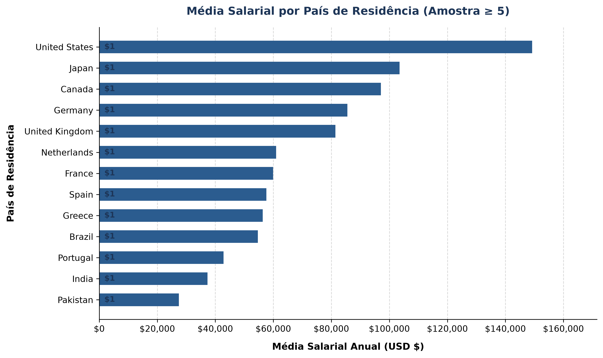
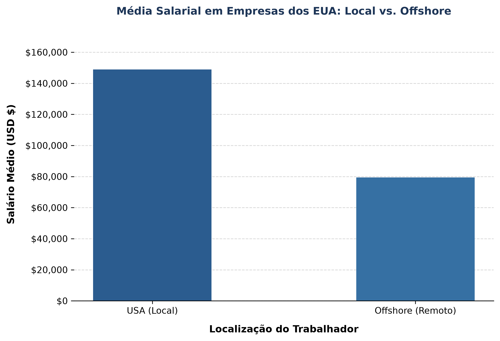
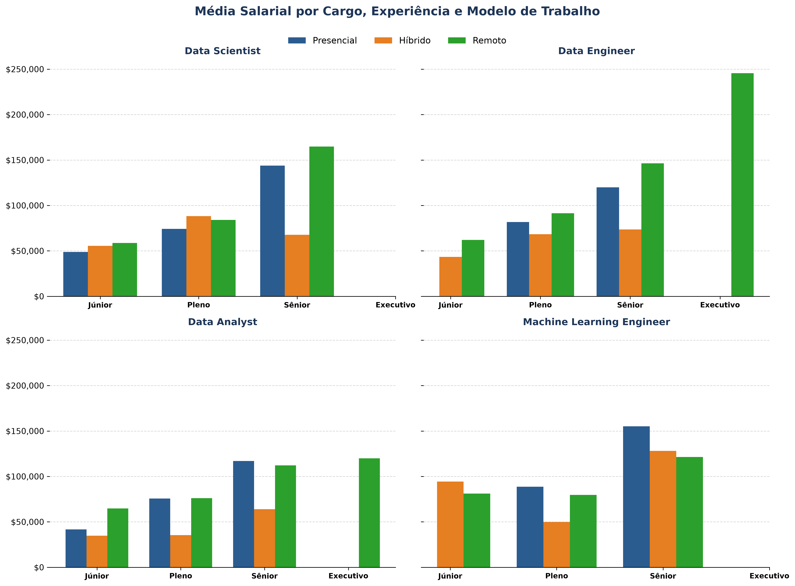

# 📊 Data Science Job Salaries Analysis

Este repositório contém uma análise exploratória e estatística sobre a remuneração global na área de **Data Science** e **Tecnologia**. O objetivo do projeto é mapear como o **nível de experiência**, a **localização geográfica (local vs. offshore)**, o **tamanho da empresa** e o **modelo de trabalho (presencial, híbrido e remoto)** impactam os salários anuais em dólares (USD).

O projeto foi desenvolvido seguindo boas práticas de engenharia de software e **Clean Code**: arquitetura modular, centralização de configurações no `config.py` e separação rigorosa entre processamento de dados e geração gráfica.

---

## 📈 Principais Descobertas

* **Amostra Analisada**: 607 registos de profissionais de dados.
* **Salário Médio Global**: **\$112,297.87 USD / ano**.
* **Média Salarial por Nível de Experiência**:
  * **EN (Júnior)**: \$61,643.32 USD
  * **MI (Pleno)**: \$87,996.06 USD (+42.8% — *maior salto salarial percentual*)
  * **SE (Sénior)**: \$138,617.29 USD (+57.5%)
  * **EX (Executivo)**: \$199,392.04 USD (+43.8% — *maior salto absoluto*)
* **Diferença Salarial USA vs. Offshore**:
  * **USA (Local)**: \$148,955.90 USD (+87.7% vs. Offshore)
  * **Offshore (Remoto Internacional)**: \$79,366.84 USD
* **Impacto do Porte da Empresa e Modelo de Trabalho**:
  * **Porte**: Empresas de grande (**L**) e médio (**M**) porte pagam salários significativamente superiores às de pequeno porte (**S**).
  * **Modelo de Trabalho**: O isolamento da senioridade em cada cargo (painel 2x2) revela a real variação de remuneração entre regimes presencial, híbrido e remoto sem o viés da concentração de seniores no remoto.

---

## 🎨 Visualizações e Gráficos

### 1. Progressão Salarial por Experiência e Comparação Geográfica


---

### 2. Média Salarial por País e Impacto do Modelo Offshore (EUA)



---

### 3. Impacto do Porte da Empresa e do Modelo de Trabalho por Cargo



---

## 🛠️ Tecnologias Utilizadas

* **Python 3.13**
* **Pandas** (Tratamento, limpeza e agregação de dados)
* **Matplotlib** (Visualização e geração de gráficos de alta resolução)
* **NumPy** (Cálculos numéricos e operações vetoriais)

---

## 📁 Estrutura do Repositório

```text
ds-salaries-analysis/
│
├── dados/                         # Datasets brutos (CSVs)
│   ├── ds_salaries.csv            # Registo de salários globais
│   └── iso_3166_data.csv          # Tabela de mapeamento dos códigos ISO dos países
│
├── imagens/                       # Gráficos exportados automaticamente
│   ├── grafico_salarios_experiencia.png
│   ├── grafico_salarios_paises.png
│   ├── grafico_salarios_offshore.png
│   ├── grafico_salarios_tamanho_empresa.png
│   └── grafico_salarios_remoto_presencial.png
│
├── scripts/                       # Módulos Python de análise e gráficos
│   ├── s01_exploracao.py
│   ├── s02_analise_salario_exp.py
│   ├── s03_grafico_salario_exp.py
│   ├── s04_analise_geografica.py
│   ├── s05_grafico_paises.py
│   ├── s06_grafico_us_offshore.py
│   ├── s07_analise_tamanho_empresa.py
│   ├── s08_grafico_tamanho_empresa.py
│   ├── s09_analise_remoto_presencial.py
│   └── s10_grafico_remoto_presencial.py
│
├── config.py                      # Configuração centralizada de caminhos (pathlib.Path)
└── README.md                      # Documentação principal do projeto

```

---

## 📋 Módulos da Pipeline (`scripts/`)

| Script                                  | Tipo            | Função &amp; Responsabilidade                                                                                                      |
| --------------------------------------- | --------------- | ------------------------------------------------------------------------------------------------------------------------------ |
| **config.py** *(Raiz)*                  | ⚙️ *Config*     | Centralização de constantes e caminhos dinâmicos de dados e imagens via `pathlib.Path`.                                        |
| **s01\_exploracao.py**                  | 🔍 *Exploração* | Inspeção inicial da estrutura (`.info()`, `.describe()`) e identificação de valores discrepantes.                              |
| **s02\_analise\_salario\_exp.py**       | 📊 *Análise*    | Agrupamento por nível de experiência (`EN`, `MI`, `SE`, `EX`), diferenças absolutas e percentuais.                             |
| **s03\_grafico\_salario\_exp.py**       | 🎨 *Gráfico*    | Visualização da progressão de carreira por nível de experiência *(importa* *df\_resumo* *do* *s02* *)*.                        |
| **s04\_analise\_geografica.py**         | 📊 *Análise*    | Mapeamento dos códigos ISO 3166, criação da flag `offshore` e comparação US Local vs. Offshore.                                |
| **s05\_grafico\_paises.py**             | 🎨 *Gráfico*    | Gráfico de barras horizontais do salário médio por país de residência *(importa* *df\_paises\_filtrado* *do* *s04* *)*.        |
| **s06\_grafico\_us\_offshore.py**       | 🎨 *Gráfico*    | Comparação de empresas dos EUA entre funcionários locais e contratações *Offshore* *(importa do* *s04* *)*.                    |
| **s07\_analise\_tamanho\_empresa.py**   | 📊 *Análise*    | Mapeamento dos portes de empresa (`S`, `M`, `L`) e variações relativas.                                                        |
| **s08\_grafico\_tamanho\_empresa.py**   | 🎨 *Gráfico*    | Gráfico de barras por tamanho de empresa *(importa* *df\_resumo* *do* *s07* *)*.                                               |
| **s09\_analise\_remoto\_presencial.py** | 📊 *Análise*    | Processamento em loop para os 4 principais cargos por senioridade e modelo de trabalho.                                        |
| **s10\_grafico\_remoto\_presencial.py** | 🎨 *Gráfico*    | Painel em grade 2x2 com subplots comparando a remuneração por cargo, senioridade e modelo de trabalho *(importa do* *s09* *)*. |

---

## 💻 Como Executar o Projeto

### 1\. Pré-requisitos

Certifique-se de ter o Python instalado e as bibliotecas necessárias:

```
pip install pandas matplotlib numpy

```

### 2\. Executar um Script de Análise (Terminal)

Para processar os dados e visualizar as tabelas explicativas e métricas diretamente no terminal:

```
python scripts/s07_analise_tamanho_empresa.py

```

### 3\. Gerar um Gráfico

Para executar um script de visualização e exportar a imagem correspondente para a pasta `imagens/`:

```
python scripts/s10_grafico_remoto_presencial.py

```

ℹ️ **Nota:** O comando acima salva a imagem em alta resolução (`.png`) na pasta `imagens/`.

### 4\. Visualizar o Gráfico Gerado

Abra a imagem diretamente pelo explorador do VS Code ou pelo terminal:

* **macOS**: `open imagens/grafico_salarios_remoto_presencial.png`
* **Linux**: `xdg-open imagens/grafico_salarios_remoto_presencial.png`
* **Windows (PowerShell)**: `Start-Process imagens\grafico_salarios_remoto_presencial.png`