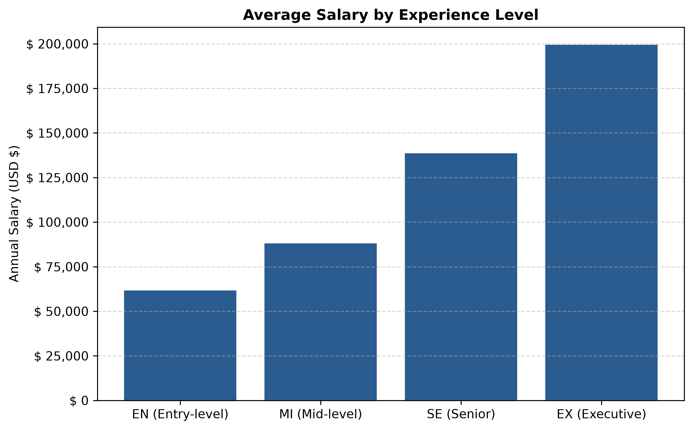
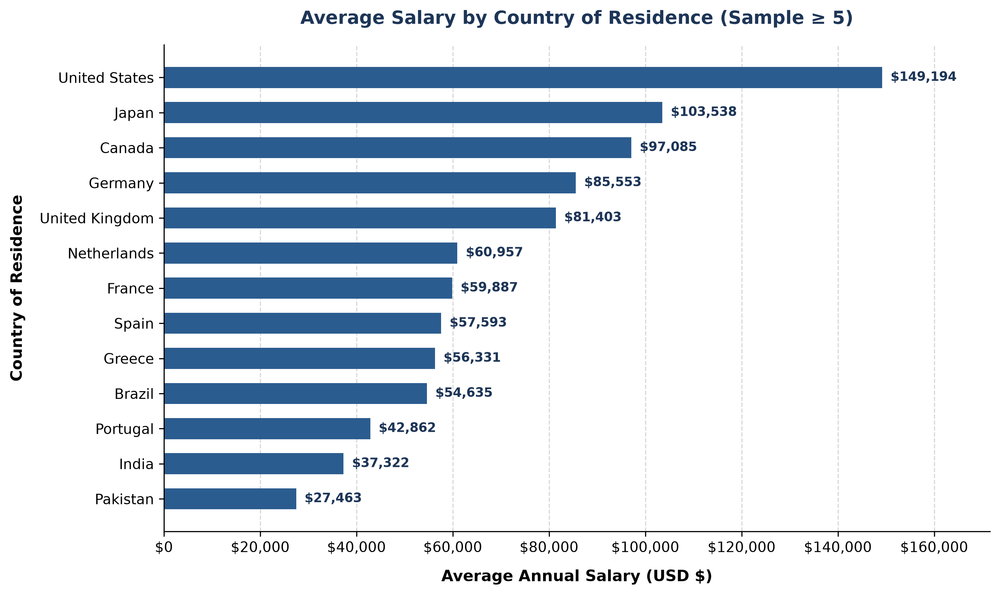
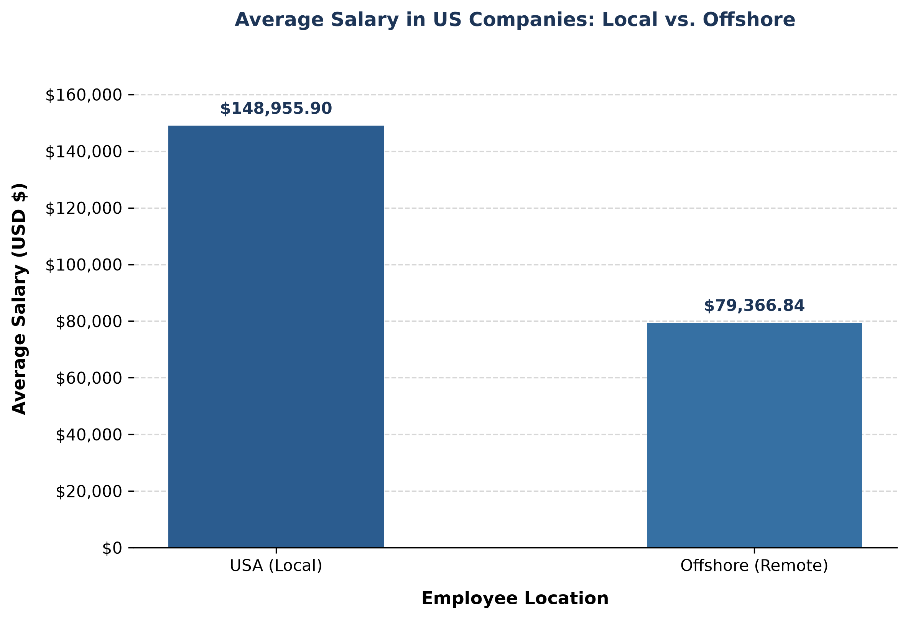
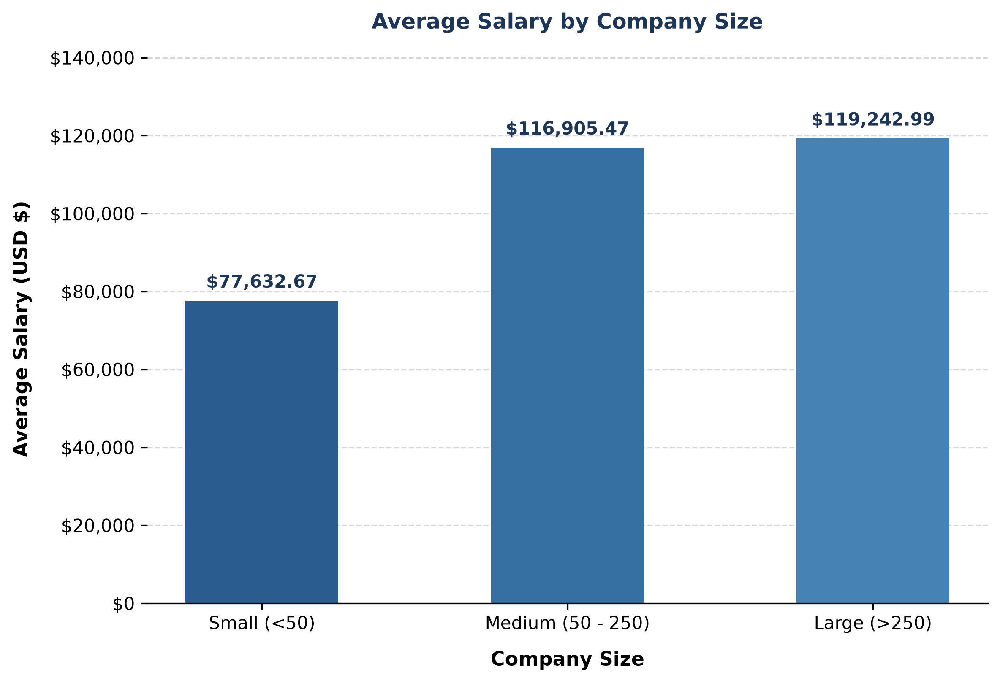
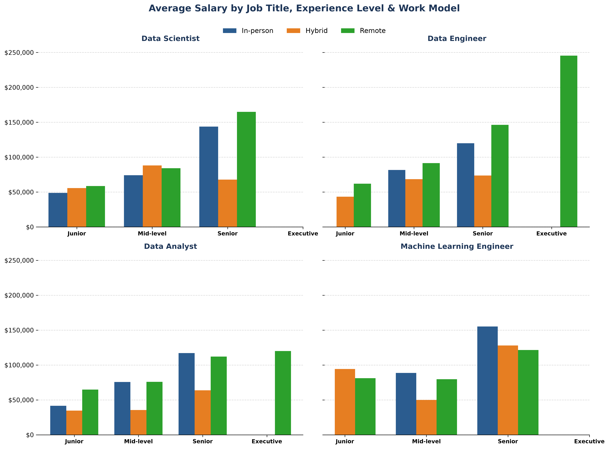

# 📊 Data Science Job Salaries Analysis

This repository contains an exploratory and statistical analysis of global compensation in **Data Science** and **Tech**. The objective of the project is to map how **experience level**, **geographic location (local vs. offshore)**, **company size**, and **work model (in-person, hybrid, and remote)** impact annual salaries in US Dollars (USD).

The project was developed following software engineering best practices and **Clean Code** principles: modular architecture, centralized configuration in `config.py`, and strict separation between data processing and chart generation.

---

## 📈 Key Findings

* **Analyzed Sample**: 607 data professional records.
* **Global Average Salary**: **$112,297.87 USD / year**.
* **Average Salary by Experience Level**:
  * **EN (Entry-level / Junior)**: $61,643.32 USD
  * **MI (Mid-level)**: $87,996.06 USD (+42.8% — *highest percentage salary jump*)
  * **SE (Senior)**: $138,617.29 USD (+57.5%)
  * **EX (Executive)**: $199,392.04 USD (+43.8% — *highest absolute jump*)
* **US vs. Offshore Salary Gap**:
  * **US (Local)**: $148,955.90 USD (+87.7% vs. Offshore)
  * **Offshore (International Remote)**: $79,366.84 USD
* **Impact of Company Size and Work Model**:
  * **Company Size**: Large (**L**) and medium (**M**) sized companies pay significantly higher salaries than small (**S**) ones.
  * **Work Model**: Isolating seniority within each job title (2x2 panel) reveals the true compensation variation across in-person, hybrid, and remote setups without the bias of remote senior concentration.

---

## 🎨 Visualizations & Charts

### 1. Salary Progression by Experience & Geographic Comparison


---

### 2. Average Salary by Country & Impact of US Offshore Model



---

### 3. Impact of Company Size & Work Model by Job Title



---

## 🛠️ Technologies Used

* **Python 3.13**
* **Pandas** (Data wrangling, cleaning, and aggregation)
* **Matplotlib** (High-resolution visualization and plot generation)
* **NumPy** (Numerical computing and vector operations)

---

## 📁 Repository Structure

```text
ds-salaries-analysis/
│
├── data/                                          # Raw datasets (CSVs)
│   ├── ds_salaries.csv                            # Global salary records
│   └── iso_3166_data.csv                          # Country ISO code mapping table
│
├── images/                                        # Automatically exported charts
│   ├── experience_salaries_chart.png
│   ├── country_salaries_chart.png
│   ├── offshore_salaries_chart.png
│   ├── company_size_chart.png
│   └── remote_chart.png
│
├── scripts/                                       # Python analysis and visualization modules
│   ├── s01_exploration.py
│   ├── s02_salary_exp_analysis.py
│   ├── s03_salary_exp_chart.py
│   ├── s04_geographic_analysis.py
│   ├── s05_country_salary_chart.py
│   ├── s06_us_offshore_chart.py
│   ├── s07_company_size_analysis.py
│   ├── s08_company_size_chart.py
│   ├── s09_remote_inperson_analysis.py
│   └── s10_remote_inperson_chart.py
│  
├── config.py                                      # Centralized path configuration (pathlib.Path)
└── README.md                                      # Main project documentation
```

---

## 📋 Pipeline Modules (`scripts/`)

| Script | Type | Function & Responsibility |
| :--- | :--- | :--- |
| **`config.py`** *(Root)* | ⚙️ *Config* | Centralized constants and dynamic paths for data and images via `pathlib.Path`. |
| **`s01_exploration.py`** | 🔍 *Exploration* | Initial structure inspection (`.info()`, `.describe()`) and outlier identification. |
| **`s02_salary_exp_analysis.py`** | 📊 *Analysis* | Grouping by experience level (`EN`, `MI`, `SE`, `EX`), absolute and percentage differences. |
| **`s03_salary_exp_chart.py`** | 🎨 *Chart* | Career progression visualization by experience level *(imports `df_summary` from `s02_salary_exp_analysis`)*. |
| **`s04_geographic_analysis.py`** | 📊 *Analysis* | ISO 3166 code mapping, `offshore` flag creation, and US Local vs. Offshore comparison. |
| **`s05_country_salary_chart.py`** | 🎨 *Chart* | Horizontal bar chart of average salary by country of residence *(imports `df_filtered_countries` from `s04_geographic_analysis`)*. |
| **`s06_us_offshore_chart.py`** | 🎨 *Chart* | US company comparison between local employees and *Offshore* hires *(imports `df_us_grouped` from `s04_geographic_analysis`)*. |
| **`s07_company_size_analysis.py`**| 📊 *Analysis* | Company size mapping (`S`, `M`, `L`) and relative variations. |
| **`s08_company_size_chart.py`**| 🎨 *Chart* | Bar chart by company size *(imports `df_summary` from `s07_company_size_analysis`)*. |
| **`s09_remote_inperson_analysis.py`**| 📊 *Analysis* | Loop processing for top 4 job titles by seniority and work model. |
| **`s10_remote_inperson_chart.py`**| 🎨 *Chart* | 2x2 grid panel with subplots comparing compensation by job title, seniority, and work model *(imports `tables_by_job` from `s09_remote_inperson_analysis`)*. |

---

## 💻 How to Run the Project

### 1. Prerequisites

Make sure you have Python installed along with the required libraries:

```bash
pip install pandas matplotlib numpy
```

### 2. Run an Analysis Script (Terminal)

To process the data and display explanatory tables and metrics directly in the terminal:

```bash
python scripts/s07_company_size_analysis.py
```

### 3. Generate a Chart

To execute a visualization script and export the corresponding image to the `images/` folder:

```bash
python scripts/s10_remote_inperson_chart.py
```

ℹ️ **Note:** The command above saves a high-resolution image (`.png`) in the `images/` folder.

### 4. View the Generated Chart

Open the image directly via the VS Code file explorer or through the terminal:

* **macOS**: `open images/remote_chart.png`
* **Linux**: `xdg-open images/remote_chart.png`
* **Windows (PowerShell)**: `Start-Process images\remote_chart.png`
